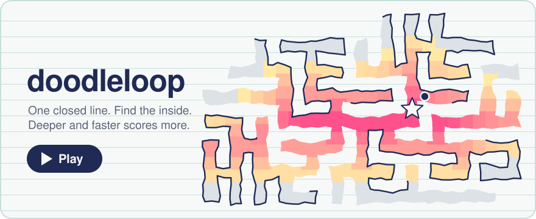

# doodleloop

A tiny puzzle game based on a doodle I've drawn since I was a kid: one wiggly line that branches like coral and always closes on itself.

**Goal:** tap a spot inside the loop.

- Deeper inside scores more. Taps near the easy outer edge cost points.
- Faster taps get a bonus.
- Miss three times and it's game over.
- From level 9, decoy loops with a small gap show up. Only one loop is sealed.

**[▶ Play it](https://abdielou.github.io/doodleloop/)** (works best on a phone)

## How the doodles are made
Every doodle is the outline of a randomly grown tree on a grid. The outline of a tree is always a single closed line that never crosses itself, so there's always exactly one inside.

## Files
- `index.html`: the whole game, no build step.
- `doodleloop-preview.svg`: animated banner; regenerate with `node tools/make-preview.js`.
- `tests/loop-invariants.js`: checks that generated loops never cross.
